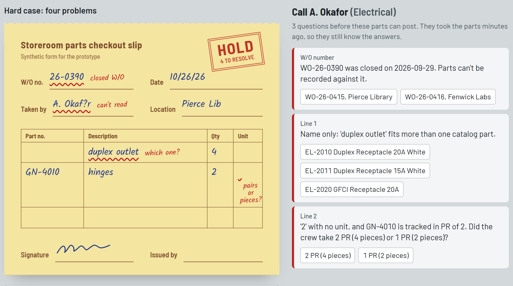
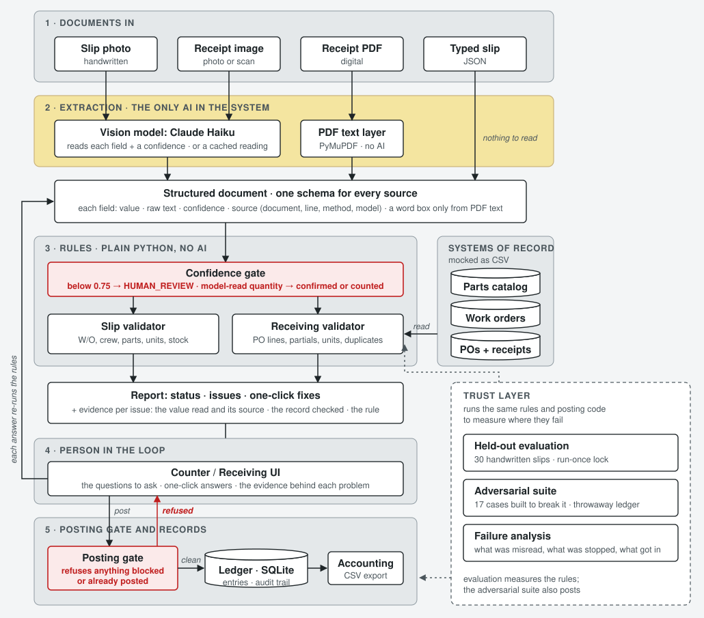

# Slip Check: catch storeroom slip errors at the counter

In a facilities storeroom, crews take parts against a handwritten slip. Mistakes on the slip
(an old, closed work order, a "2" for a part tracked in pairs, a part name with no number,
unreadable handwriting) are made at the counter in seconds but found days later at the stock
count, when the crew has moved on. **Slip Check checks the slip the moment it is entered**,
and tells the clerk exactly what to ask the crew while they are still there. The same pattern
checks **delivery receipts against purchase orders** on the receiving side.

It comes with the evidence for how far to trust it: a held-out evaluation on handwritten slips
([EVAL.md](EVAL.md)), an adversarial suite of cases built to break it, a failure analysis, and
the evidence behind every problem it raises.

**Walkthrough video:** [5 min](https://drive.google.com/file/d/13vSLpkyE_olFqDWKH8nPYvmO8nOQbQXe/view?usp=sharing)
(recorded for the first version, before receiving, the evaluation and the new sections) ·
**Screenshot:** [hard case on hold](docs/hard_case.png)



## Quick start

Python 3.10+. No API key, paid service or Node needed (the built web UI is included).

```bash
python -m venv .venv
.venv\Scripts\activate            # macOS/Linux: source .venv/bin/activate
pip install -r requirements.txt
python -m slipcheck serve         # then open http://127.0.0.1:8000
```

**Try it (about five minutes):**
1. **Counter:** open **Hard case: four problems** → pick *WO-26-0415* → pick a receptacle → pick
   *1 PR* → type the name into the review box → *The paper says 4* (the model read that quantity,
   so a person confirms it) → the stamp turns to **READY TO POST** → **Post to inventory**.
2. **Evidence:** under the slip, in **Evidence for each problem**, pick *W/O number CLOSED_WO*. It
   shows the value read, the work order as the system has it (closed 2026-09-29), the rule, and
   your correction (26-0390 → WO-26-0415). Open **slip hard case** (the photo) and pick
   *PART_AMBIGUOUS* to see the "dupler outlet" misread at 0.80 and why it was still stopped.
3. **Receiving:** open **R03** (over-shipment): the evidence zooms to the "8" on the PDF and shows
   the PO line (6 ordered, 0 received, 6 open).
4. **Failure analysis** and **Adversarial suite** (left, under "Does it hold up?"): where it fails,
   and the cases that got through.

Run the tests with `pytest`.

## How it works



Top to bottom:
1. **Documents in:** slip photos, typed slips, receipt images and receipt PDFs.
2. **Extraction, the only AI step:** the vision model reads photos and images; PDFs are read
   from their text layer with no AI. Every field keeps its value, raw text, confidence and source.
3. **Rules, no AI:** a field read below 0.75 confidence gets a `HUMAN_REVIEW` block instead of
   being trusted, and the rest of the document is still checked against the systems of record.
   The report carries each issue with its one-click fixes and its evidence.
4. **Person in the loop:** the clerk answers in the UI, and each answer re-runs the rules on the
   corrected document.
5. **Posting gate:** refuses anything still blocked or already posted, then writes the entry and
   its audit trail.

The trust layer (dotted lines) runs the same rules and posting code to measure where they fail. The
diagram is a hand-drawn SVG (`docs/architecture.svg`), so it shows in any Markdown viewer.

**AI only reads; rules decide.** The vision model transcribes the handwriting and gives a
confidence per field. Every decision (does this W/O exist, is it open, which unit, is there
enough stock) is plain code against the catalog and the work orders, so it is repeatable,
testable, and explainable to a supervisor or an auditor.

What that design guarantees, and what it doesn't:
- **An uncertain read cannot post silently.** A read below 0.75 confidence is a block, and posting
  refuses anything with a block. A person has to settle it from the paper.
- **A confident misread can't post on confidence alone.** No rule can tell a "6" read as "9" at
  0.95 from the truth, and no threshold fixes that. So every quantity a model read must be
  confirmed by a person (slips: `CONFIRM_QTY`) or counted (receipts read from an image: a blind
  count, `BLIND_COUNT`). That is an independent check, and it is not free: every photographed slip
  now needs a person.
- **Warnings inform; they don't stop.** A clerk can post past one. Anything that would attribute a
  transaction to the wrong record is therefore a block, not a warning (another crew's work order,
  a size that contradicts the part number, the wrong vendor).
- **Not guaranteed:** a person who confirms without looking, and a photo filed against the wrong
  slip (every field is consistent with itself; see EVAL.md).

**Rules v1 and v2.** The rules the evaluation froze are kept as `v1`, so the recorded results
still reproduce. The app runs `v2`, which closes three gaps the adversarial suite found (S2, S3,
S4). v2 was checked on the development set; on the held-out set it can only be re-scored, and that
is labelled, because the rules were written after those slips were seen.

## Using the app

The sections are in the left-hand navigation, in three groups: **At the counter** (Counter,
Receiving), **Records** (Shift log, Data) and **Does it hold up?** (Failure analysis,
Adversarial suite, Impact).

| Section | What it shows |
|---|---|
| **Counter** | The slip drawn as the paper copy, problems marked next to each field, a HOLD / READY TO POST stamp, and the questions to ask the crew with one-click answers. Answering re-checks the slip; corrections appear over the struck-through original. Drop in your own photo or JSON slip on the left. |
| **Evidence for each problem** (under the slip on Counter, and under the receipt on Receiving) | Pick any problem, open or already answered, and see the chain behind it: (1) the document (the photo and line for a handwritten slip; a zoom on the real word box for a PDF; no invented boxes for vision reads), (2) the value read with its confidence and method, (3) the record it was checked against (the work order, catalog part, PO line or receiving history), (4) the rule in plain words and whether it blocks or only warns, (5) the clerk's correction, before and after. Evidence is built after validation (`slipcheck/evidence.py`), so it explains decisions without taking part in them. |
| **Receiving** | A delivery receipt checked against its purchase order. The page is shown with each problem's real word box drawn on it (PDF text layer; images read by the vision model get no invented boxes). Over-shipments, pack-size questions, unordered items, duplicates and closed POs block with one-click decisions (receive the open amount, accept, return to vendor, hold for the buyer); a short delivery is a partial, not a failure, and the PO line stays open. |
| **Failure analysis** | Where reading plus rules goes wrong, from the saved evaluation results (nothing re-run): headline numbers, a 30-second summary, misreads per field split by what the checker did (stopped, warned only, nothing raised), confidence against correctness with the review threshold, every wrong value nothing stopped, each with an **Inspect** button that opens the original photo, the value read and its source, the answer key, and what the checker raised on that field (and can open the reading in the Counter), false positives split into reviews and blocks (which stop posting) and warnings (which don't), review load per slip, and results by handwriting style, photo condition and document type. Switch between held-out corrected, held-out locked, development, and the rules-v2 re-scores. |
| **Adversarial suite** | Deliberately difficult cases (a duplicate under a new file name or receipt number, the right PO from the wrong supplier, partial then over deliveries, confident misreads), each with what *should* happen next to what did. They run live, through the same rules and posting code, in a throwaway ledger. Known gaps are listed first, each with why it got in and what would close it. See [Adversarial suite](#adversarial-suite). |
| **Shift log** | What was posted (W/O, location, parts, aisles, answers given at the counter), what is on hold and why, slips waiting on a handwriting check, problems caught before the count, stock after posting, and **Download for accounting (CSV)**: one row per posted part with the cause of every correction. |
| **Data** | Every part with start, posted and on-hand (low stock flagged), every work order with what was issued against it, and a feed of stock changes. Rows changed by the latest posting are highlighted; refreshes every few seconds. |
| **Impact (modeled)** | A model, not a measurement: manual vs with the check, with a slider for every input tagged Observed or Assumed and the break-even marked. See [Time and cost](#time-and-cost-a-model-not-a-measurement). |

"Post to inventory" re-checks the slip on the server, refuses anything still blocked or
already posted (same W/O, person, date and parts), and lowers on-hand, so the next slip for
that part is checked against the reduced stock. Postings go to a local SQLite file
(`data/runtime/ledger.db`, git-ignored, override with `SLIPCHECK_DB`); nothing leaves the
machine. **Clear shift log** resets it.

## Command line and photos

```bash
python -m slipcheck demo                                       # every sample, one line each
python -m slipcheck check data/slips/01_clean.json             # representative case
python -m slipcheck check data/slips/10_hard_case.json         # difficult case
python -m slipcheck check data/slips/12_truncated.json         # invalid input -> rejected, exit 2
python -m slipcheck check data/slips/10_hard_case.json --json  # machine-readable report
python -m slipcheck impact                                     # modeled (not measured) manual vs checked comparison
python -m slipcheck receive demo                               # every sample delivery receipt, one line each
python -m slipcheck receive data/receiving/receipts/R03.pdf    # one receipt in full (over-shipment)
python -m slipcheck adversarial                                # difficult cases: expected vs actual (exit 1 on a regression)
python -m slipcheck eval --split dev                           # evaluation of photo reading + rules (see EVAL below)
python -m slipcheck eval --split heldout --corrected          # held-out result with the recorded correction (no API calls)
python -m slipcheck eval --split heldout --rescore            # the locked run re-scored with the stricter 'would be posted' rows
python -m slipcheck eval --split dev --ruleset v2              # the current rules (v2) on development data

python -m slipcheck check data/photos/slip_hard_case.jpeg                    # photo, cached reading (no key)
python -m slipcheck check data/photos/slip_hard_case.jpeg --live             # photo, read live (ANTHROPIC_API_KEY)
python -m slipcheck check data/photos/slip_hard_case.jpeg --live --save-extraction   # refresh the cached reading
```

Live mode uses Claude Haiku (`SLIPCHECK_MODEL` to override), one call per slip, well under a
cent each. The key can go in a `.env` file in the project folder.

**What happened on the real photos** (two slips handwritten on ruled paper):
- `slip_clean.jpeg` was read exactly. Under rules v2 it still waits for a person to confirm its two
  quantities (`CONFIRM_QTY`), as every photographed slip does; under v1 it came out `READY`.
- `slip_hard_case.jpeg` came out `BLOCKED` with CLOSED_WO, PART_AMBIGUOUS and UNIT_AMBIGUOUS.
- The model misread "duplex outlet" as **"dupler outlet" at 0.80 confidence**, above the 0.75
  review threshold, so its own confidence did not flag the mistake. The rules still did: the
  misread name matched both duplex receptacles equally, so the crew is asked which one, and
  nothing wrong gets posted. **This is why AI only reads and the rules decide.**
- The name was read at 0.85, so no HUMAN_REVIEW this time; `10_hard_case.json` shows that path.

## Sample data (all synthetic)

| File | What it is |
|---|---|
| `data/catalog.csv` | 60 parts (plumbing, electrical, HVAC, carpentry, paint, custodial): number, name, aliases, **unit of issue** (EA / PR / BX / RL) and pieces per unit, aisle, on-hand, usual max per pull |
| `data/work_orders.csv` | 30 work orders across 10 crews, open and closed, with crew members, location, dates |
| `data/slips/*.json` | 20 slips as a clerk would type them: clean pulls, one per failure mode, a multi-line weekly pull |
| `data/photos/` | two handwritten slips, photographed (see `WHAT_TO_WRITE.md`) |
| `data/extractions/*.json` | the cached Claude readings of those photos, replayed in mock mode |
| `data/receiving/purchase_orders.csv` | 12 purchase orders from 3 invented vendors: the system of record for receiving |
| `data/receiving/receipts_seed.csv` | deliveries already received before the demo (so partial and closed POs exist) |
| `data/receiving/receipts/` | 12 digital delivery-receipt PDFs (one per scenario, see `scenarios.csv`) and one image receipt for the vision path |
| `data/eval/` | the evaluation set: `WRITE_THESE.md`, `labels.csv` (what each handwritten slip says), photos, cached readings, `corrections.json` (the recorded photo swap), the results files and the held-out lock (`.heldout_run.json`) |
| `data/impact_assumptions.json` | inputs to the impact estimate, each tagged observed / assumed / unknown |
| `forms/checkout_slip.html` | printable blank slip (optional; a hand-drawn slip works too) |

Buildings, crews, names, part numbers and W/O numbers are invented.

## Examples: input → expected output

| Input | Status | Why |
|---|---|---|
| `01_clean.json` | `READY` | everything checks out |
| `02_closed_wo.json` | `BLOCKED` | CLOSED_WO, suggests WO-26-0412 (same crew + location) |
| `03_pairs_no_unit.json` | `BLOCKED` | UNIT_AMBIGUOUS: "2" hinges = 2 PR or 1 PR? |
| `04_pieces_converted.json` | `READY` | "4 pcs" gloves converted to 2 PR |
| `05_name_only_clear.json` | `READY` | "wax ring", "flapper" auto-matched (score 100 vs next best < 50) |
| `06_name_only_ambiguous.json` | `BLOCKED` | PART_AMBIGUOUS: 20x20 vs 24x24 filter |
| `07_unsigned_big_pull.json` | `BLOCKED` | MISSING_SIGNATURE, UNUSUAL_QTY (30 tubes vs usual max 12) |
| `08_wo_typo.json` | `BLOCKED` | UNKNOWN_WO "26-0142", suggests WO-26-0412 (transposed digits) |
| `09_exceeds_on_hand.json` | `BLOCKED` | EXCEEDS_ON_HAND: 8 belts vs 6 in the system, so recount aisle C04 |
| `10_hard_case.json` | `BLOCKED` | **closed W/O + name-only part + ambiguous "2" + illegible name** |
| `11_invalid_input.json` | `BLOCKED` | blank W/O, name and signature, "a few" qty, junk line: all reported, no crash |
| `12_truncated.json` | `REJECTED` (exit 2) | not valid JSON |
| `13_custodial_restock.json` | `READY` | 4-line restock in boxes, rolls and each |
| `14_ear_plugs_in_pieces.json` | `READY` | "10 pcs" ear plugs converted to 5 PR |
| `15_not_on_crew.json` | `BLOCKED` | NOT_ON_CREW: electrician from another crew on this W/O; answers are their own crew's open W/Os, or a recorded confirmation that they are helping (a warning in v1) |
| `16_wrong_building.json` | `READY_WITH_WARNINGS` | LOCATION_MISMATCH: slip says Knox Hall, W/O is Alcott Residence |
| `17_name_contradicts_number.json` | `BLOCKED` | NAME_NUMBER_MISMATCH: "exit sign" next to a breaker's number |
| `18_same_part_twice.json` | `READY_WITH_WARNINGS` | DUPLICATE_PART: drywall sheets on two lines |
| `19_dated_before_wo.json` | `READY_WITH_WARNINGS` | BEFORE_WO_OPENED |
| `20_weekly_plumbing_pull.json` | `BLOCKED` | 5 lines: two name-only lines matched, "ball valve" ambiguous, "3 pcs" gloves not whole pairs |

Representative case, `python -m slipcheck check data/slips/01_clean.json`:

```
Status: READY
W/O WO-26-0412 | crew Plumbing A | taken by J. Rivera | Harlow Hall | 2026-10-22

Entry to post:
  1. 6 EA           PL-1001 PVC Elbow 90 deg 3/4 in [aisle A03]
  2. 2 EA           PL-1010 Ball Valve 3/4 in Brass [aisle A04]

Nothing to ask the crew. Ready to post.
```

<details>
<summary>Difficult case, full output of <code>python -m slipcheck check data/slips/10_hard_case.json</code></summary>

```
Status: BLOCKED
W/O WO-26-0390 | crew Electrical | taken by A. Okafor | Pierce Library | 2026-10-26

Entry to post:
  1. 4              UNRESOLVED PART
  2. ? (unresolved) GN-4010 Door Hinge 4.5 in Satin Nickel [aisle D02]

Issues:
  [BLOCK] CLOSED_WO            wo_number: WO-26-0390 was closed on 2026-09-29. Parts can't be recorded against it.
           -> Move to WO-26-0415 (OPEN, Electrical, Pierce Library)
           -> Move to WO-26-0416 (OPEN, Electrical, Fenwick Labs)
  [BLOCK] HUMAN_REVIEW         taken_by: Low-confidence read 'A. Okaf?r' (confidence 0.62). Check against the paper slip; not guessed.
  [BLOCK] PART_AMBIGUOUS       line 1: Name only: 'duplex outlet' fits more than one catalog part.
           -> EL-2010 Duplex Receptacle 20A White [aisle B03] (match 100)
           -> EL-2011 Duplex Receptacle 15A White [aisle B03] (match 100)
           -> EL-2020 GFCI Receptacle 20A [aisle B03] (match 75)
  [BLOCK] UNIT_AMBIGUOUS       line 2: '2' with no unit, and GN-4010 is tracked in PR of 2. Did the crew take 2 PR (4 pieces) or 1 PR (2 pieces)?
           -> 2 PR
           -> 1 PR

Call A. Okafor (Electrical) now and ask:
  1. [wo_number] WO-26-0390 was closed on 2026-09-29. Parts can't be recorded against it.
     Suggested: Move to WO-26-0415 (OPEN, Electrical, Pierce Library)
  2. [line 1] Name only: 'duplex outlet' fits more than one catalog part.
     Options: EL-2010 Duplex Receptacle 20A White | EL-2011 Duplex Receptacle 15A White | EL-2020 GFCI Receptacle 20A
  3. [line 2] '2' with no unit, and GN-4010 is tracked in PR of 2. Did the crew take 2 PR (4 pieces) or 1 PR (2 pieces)?
     Options: 2 PR | 1 PR
```

</details>

## Time and cost: a model, not a measurement

**This is not a time-saving claim.** Nobody has timed a slip entered by hand against one entered
through Slip Check, or timed a review. The model below has a stated input for every number, and it
leaves out a cost the evaluation did measure: **75% of handwritten slips needed a person to confirm
a field**, which would add counter time the model doesn't include. Treat it as a hypothesis about
where the value would come from, to be replaced by a timing pilot.

Storeroom volumes are observed (10-20 slips a normal day, 7-8 count mismatches a week, 30-60
minutes to chase each); most other inputs are assumed. Only the detection rate is measured: the
real checker was run on 2,100 synthetic slips with one known error each and caught **79%** of slip
errors, weighted by an assumed mix.

| | Likely | Optimistic |
|---|---|---|
| Staff hours a week chasing mismatches (today → with check) | 5.6 → 3.8 | 8.0 → 3.1 |
| **Staff hours saved a year** | **+92** (about $2,600) | **+244** |
| **Pays off if at least this share of mismatches start on a slip** | **6%** | **0%** |

If the model's assumptions hold, the break-even is low: about 6% of count mismatches would have
to start as a slip error. What would sink it is almost all drift coming from
somewhere else (parts taken with no slip, receiving errors, loss); a two-week pilot alongside
the paper process measures exactly that. Run `python -m slipcheck impact` for the full table,
or use the Impact section to change any input.

<details>
<summary>Inputs, detection by error type, and model limits</summary>

| Input | Low / likely / high | Source |
|---|---|---|
| Slips per week | 50 / 85 / 150 | **observed** |
| Count mismatches per week | 7 / 7.5 / 8 | **observed** |
| Minutes to chase one mismatch | 30 / 45 / 60 | **observed** |
| Share of mismatches caused by a slip error | 20% / 50% / 80% | **assumed**: the key unknown |
| Mix of error types | see file | types **observed**, frequencies **assumed** |
| Minutes to answer a flag at the counter | 2 / 3 / 5 | assumed |
| Seconds the check adds to every slip | 0 / 10 / 20 | assumed |
| Mismatches never traced (left for the yearly audit) | 10% / 25% / 40% | assumed |
| Staff hourly cost (USD) | 22 / 28 / 35 | assumed |
| Who parts were charged to (crew or unit) | not used | **unknown**: decided by management and accounting; changes who pays, not how much |
| Receiving-document call-backs | not counted | **observed**, but about vendor receipts, which this does not touch |

| Error written on the slip | Caught |
|---|---|
| Old, closed W/O number | 100% |
| Pieces written for a pair-tracked part, no unit | 100% |
| Part name only | 100% (84% matched automatically and correctly, 16% sent to a person, 0% wrong) |
| Field too unclear to read | 100% |
| Not signed | 100% |
| Neighbouring part number with the right name | 84% (75% under v1; v2 also compares sizes) |
| Wrong but plausible quantity | 1%: these test slips are typed, and nothing contradicts a typed quantity. For model-read quantities, v2 requires a person to confirm every one |

Limits: false alarms on clean synthetic slips are 0%, which is too clean for real handwriting;
each slip error is assumed to cause one count mismatch; staff time only, with no part prices
or write-off value.

</details>

## Receiving: delivery receipt vs purchase order

The same pattern on the other side of the storeroom door. Must-have rules, all implemented:

| Problem on the receipt | What happens |
|---|---|
| PO line not on this delivery | warning; the line stays open |
| Fewer than ordered | **partial delivery** warning, not a failure; remaining quantity stays open |
| More than still open | block: receive the open amount and return the rest, accept the over-shipment, or return to vendor |
| Pieces vs boxes / pairs | converted when exact (1,000 ea = 10 boxes of 100); otherwise a question with the readings to choose from |
| Item not on the PO | block: change to the PO line it most resembles (never one already on the receipt), return, or hold for the buyer |
| Receipt number already received | block (duplicate); the over-shipment it would also cause is not reported twice |
| Same PO, date and quantities as a received receipt, under a new number | block (`POSSIBLE_DUPLICATE`); a person can confirm it is a separate delivery |
| Vendor on the receipt is not the PO's vendor | block: either the PO number is wrong or the goods are from someone else; answers are the PO's vendor (name written differently) or that vendor's own open POs |
| PO closed or fully received | block, with the vendor's open POs as options |
| PO number not in the system | block, with look-alike numbers from the same vendor |
| Nobody named as received by | block; type the name |

Price variance is deliberately not checked: these receipts confirm quantities, not prices, which
belong to a later invoice match. Posting raises each PO line's received-to-date (mocked, local
SQLite) and every check and posting lands in an audit trail (`GET /api/events`). Receiving does
not yet change on-hand stock in the Data section.

## Adversarial suite

`python -m slipcheck adversarial` (and the **Adversarial suite** section) runs 17 cases built to
break the checker. Each one states the outcome it *should* have, then runs the real validator and
the real posting step in a throwaway SQLite file, so the shift log is never touched. Current
result: **16 as expected, 1 known gap, 0 regressions.**

| | Cases |
|---|---|
| Stopped, as they should be | the same receipt under a new file name; the same delivery under a new receipt number; right PO, wrong supplier; partial, then the rest, then one too many; a second delivery bigger than what is open; a confident wrong quantity on a receipt image (A7) and on a slip (S2); a count that disagrees with the reading; an unreadable PO number; a posted slip keyed in again; a wrong W/O digit that lands on another crew's real job (S3); a part number one digit off, with the size in the description (S4); a pair-tracked part with no unit |
| Goes in, as it should | one part written in two units on one receipt (5 BX + 500 pcs); a photographed receipt whose count matches; someone from another crew, confirmed as helping |
| **Got in (known gap)** | the same delivery re-keyed with a new number **and a different date** (A11): indistinguishable from a real second delivery without the vendor's document number |

Every fix came from this suite failing first:
- **Receiving:** a re-keyed duplicate (same PO, date and quantities under a new number) now blocks
  (`POSSIBLE_DUPLICATE`); a vendor mismatch blocks instead of warning; and a quantity read from an
  image needs a blind count (`BLIND_COUNT`, `COUNT_MISMATCH`).
- **Slips, rules v2:** another crew's work order blocks (`NOT_ON_CREW`); a size that contradicts
  the part number blocks (`NAME_NUMBER_MISMATCH`); a model-read quantity needs a person's
  confirmation (`CONFIRM_QTY`).

`tests/test_adversarial.py` pins the known gap, so a gap that closes, or a new failure, shows up.

## Evaluation (exploratory)

`python -m slipcheck eval` runs the real validator twice per labelled handwritten slip, on the
true transcription and on the model's reading, and reports what the model's mistakes cost:
read correctly, misread and stopped (low-confidence review, or a block on that field), misread
and only warned about, or misread with nothing raised, and whether a wrong value would end up in
the posted entry. It also
reports confidence against observed correctness, with Wilson intervals.

Protocol: 10 development slips (thresholds may be tuned here, `--sweep`) and 20 held-out slips,
written by **one writer in four deliberate styles**. The held-out set is run once, after the rules
are frozen and committed (`--split heldout --confirm-frozen`; it refuses to run twice or with
uncommitted changes).

Held-out results (20 slips, run once after the freeze). Two photos had been saved under each
other's names; the **locked** run is the recorded result, the **corrected** column re-scores the
same readings with that one fix ([evidence in EVAL.md](EVAL.md#the-correction-and-what-it-taught)).

| Held-out, 20 slips | Locked (recorded) | Corrected |
|---|---|---|
| **Slips where a wrong critical value would be posted** | **2/20** | **0/20** (95% upper bound 16%) |
| Slips where any wrong stored value would be posted (names, dates, places) | 11/20 | 10/20 |
| Slips needing a person to confirm a field | 15/20 (75%) | 15/20 (75%) |
| Fields read at confidence 0.90+ that were still wrong | | 6/146 |

"Would be posted" means nothing stopped it: no review request and no block on that field. A
warning doesn't count as a stop, because the slip still posts. On development data 1 of 10 slips
would have posted a wrong critical value: a W/O misread that only raised warnings.

**Rules v2 on the same readings** (`--ruleset v2`; the held-out column is *not* a held-out result,
because v2 was written after those slips were seen):

| | Development, v1 → v2 | Held-out corrected, v1 → v2 |
|---|---|---|
| Slips where a wrong critical value would be posted | 1/10 → **0/10** | 0/20 → 0/20 |
| Slips where any wrong stored value would be posted | 2/10 → 1/10 | 10/20 → 8/20 |
| **Slips that need a person** (any block a correct reading wouldn't have) | 5/10 → **10/10** | 17/20 → **20/20** |

v2 trades review load for safety: every photographed slip now needs a person, mostly to confirm
quantities. The remaining wrong values that would post are names, dates and places, which no rule
checks against a record.

What this does **not** show: performance across different people's handwriting (one writer, four
styles), other slip layouts, or real catalogs; and nothing about time saved. A 75% review rate
means real extra work at the counter, and processing time has not been measured. See
[EVAL.md](EVAL.md) for the method, every definition, a table of what was and wasn't tested, and
what would measure the rest.

## Implemented / mocked / deferred

| | |
|---|---|
| **Implemented** | every check below; fuzzy part and W/O matching; unit-of-issue conversion; confidence-gated human review; one-click answers that re-check the slip; posting with duplicate protection and stock deduction; shift log; Data section; accounting CSV with the cause of each correction; receiving (receipt vs PO, partial deliveries, dispositions, audit trail); per-field provenance; evidence for every issue; held-out evaluation with a run-once lock; adversarial suite; failure analysis; web UI (React + FastAPI), CLI, JSON output; live photo reading; tests |
| **Mocked** | catalog, work orders, purchase orders and receiving history are CSVs standing in for the inventory and purchasing systems; posting writes to a local SQLite file. Photo reading defaults to replaying cached **real Claude readings**, so no key is needed |
| **Modeled, not measured** | the hours and dollars in the Impact section and from `slipcheck impact` |
| **Deferred** | a real inventory system; sign-in for several clerks; notifying crews; part prices and write-off value; multi-page slips; calibrating the model's confidence against real accuracy |

## Known limitations

- What was and wasn't tested (writers, layouts, image quality, suppliers, catalogs, model) is a table in [EVAL.md](EVAL.md#what-was-tested-and-what-wasnt), with how each gap would be measured.
- The model's own confidence is not calibrated (see "dupler" above). The review threshold (0.75) needs tuning on real slips.
- Known gap, pinned by the adversarial suite: a duplicate delivery re-keyed with a new number and a different date (A11). The former gaps A7, S2, S3 and S4 are closed in rules v2; v2 has been checked on development data only, and needs a new held-out set to be measured.
- Rules v2 require a person on every photographed slip (quantity confirmation). A person who confirms without looking defeats it; the confirmation is a forcing function, not proof.
- A photo filed against the wrong slip passes field checks, because every field agrees with itself. A document-identity check (a slip number matched to the record) would close it.
- Receipt reading accuracy is not evaluated: PDFs are read from the text layer, and there is no labelled set of photographed receipts.
- Receiving does not change on-hand stock in the Data section.
- Location matching handles prefixes ("Pierce Lib") but not arbitrary abbreviations ("Davis Sci Ctr" still warns).
- Offline OCR (e.g. Tesseract) was not used; it performs poorly on handwriting.

## How this was built (AI use)

Built with Claude Code (Claude) as a pair programmer: scaffolding, most of the
code, the UI, and drafting this README. The problem, the storeroom facts and every observed
number come from my own work in the storeroom; the AI did not supply them. How I checked its
output:
- ran every sample slip and compared each report with the failure it was written to show;
- drove the web UI in a real browser (scripted with Playwright) through the full demo path and at phone width;
- a test suite for every rule, the API, the shift log, receiving, the evaluation harness and the adversarial suite;
- an evaluation with a frozen held-out set and an adversarial suite whose expected outcomes were written before the code ran;
- corrected it where its assumptions did not fit my storeroom (for example, who parts are
  charged to is unknown to me, so it is left out, and receiving call-backs are not counted as savings).

## What I would investigate next

1. **How much stock drift comes from parts taken with no slip at all.** If that dominates, a slip checker can't fix it, and that is the result that would make me stop.
2. **How soon slips are actually entered.** Catching errors "while the crew is reachable" assumes same-day entry; batch entry at week's end shrinks the benefit.
3. Error frequency by type on real slips, to decide which checks earn their place.
4. Photo-reading accuracy on 50+ real handwritten slips from several writers, and where to set the review threshold.
5. **A new held-out set, from several writers,** to measure rules v2 cleanly, and the review time it adds.
6. **A second source for quantities** (packing list, advance ship notice, count at put-away): the only way to catch a confident, plausible misread.
7. **Three-way match.** Receiving now checks receipt against PO; adding the vendor invoice (prices) completes the match accounts payable relies on.

---

<details>
<summary>Reference: every check</summary>

| Code | Severity | Who answers |
|---|---|---|
| `CLOSED_WO`, `UNKNOWN_WO`, `MISSING_WO` | block | crew (only that crew's own open W/Os are suggested, same building first; a person on no crew gets a labeled same-building fallback with no one-click fix) |
| `UNIT_AMBIGUOUS` | block | crew. A bare number on a pair/box part is **never** converted silently |
| `UNIT_REMAINDER` | block | crew ("3 pieces" of a pair-issued part) |
| `UNIT_CONVERTED`, `UNIT_ASSUMED` | info / warn | written unit converted; odd bare number read as pairs |
| `PART_AMBIGUOUS`, `NAME_NUMBER_MISMATCH`, `NO_PART` | block | crew |
| `NAME_MATCHED` | info | auto-match only if score ≥ 88 **and** ≥ 12 ahead of the runner-up |
| `UNKNOWN_PART`, `BAD_LINE` | block | storeroom desk |
| `EXCEEDS_ON_HAND` | block | desk: slip or count is already wrong, recount the aisle |
| `NOT_ON_CREW` | block (v2; warn in v1) | crew: their own crew's open W/Os, or confirm they are helping |
| `CONFIRM_QTY` | block (v2) | desk: a quantity the model read, confirmed against the paper |
| `UNUSUAL_QTY`, `DUPLICATE_PART`, `LOCATION_MISMATCH` | warn | |
| `MISSING_SIGNATURE`, `MISSING_TAKEN_BY`, `MISSING_QTY`, `BAD_QTY` | block | crew |
| `HUMAN_REVIEW` | block | desk: any field read with confidence < 0.75; illegible ≠ blank |
| `MISSING_DATE`, `BAD_DATE`, `FUTURE_DATE`, `BEFORE_WO_OPENED` | warn | |

Receiving:

| Code | Severity | Meaning |
|---|---|---|
| `MISSING_PO`, `UNKNOWN_PO`, `PO_CLOSED` | block | no PO, a PO that does not exist, or one closed or fully received |
| `VENDOR_MISMATCH` | block | the receipt's vendor is not the PO's vendor |
| `DUPLICATE_RECEIPT`, `POSSIBLE_DUPLICATE` | block | receipt number already received; or same PO, date and quantities under another number |
| `UNORDERED_ITEM`, `NO_PART` | block | a line that matches no PO line |
| `OVER_SHIPMENT` | block | more than is still open; decide: receive the open amount, accept, or return |
| `UNIT_AMBIGUOUS`, `UNIT_REMAINDER`, `UNIT_MISMATCH` | block | pieces vs boxes or pairs that can't be settled exactly |
| `BLIND_COUNT`, `COUNT_MISMATCH`, `BAD_COUNT` | block | a quantity read from an image: count the goods; a different count blocks |
| `MISSING_RECEIVED_BY`, `MISSING_QTY`, `BAD_QTY`, `HUMAN_REVIEW` | block | |
| `SHORT_SHIPMENT`, `LINE_NOT_DELIVERED` | warn | partial delivery; the PO line stays open |
| `DUPLICATE_LINE`, `UNIT_ASSUMED`, `MISSING_RECEIPT_NUMBER`, `MISSING_DATE`, `BAD_DATE`, `FUTURE_DATE`, `BEFORE_PO_DATE` | warn | |
| `UNIT_CONVERTED`, `NAME_MATCHED`, `OVER_ACCEPTED`, `SEPARATE_DELIVERY`, `COUNT_MATCHES`, `LINE_RETURNED`, `LINE_HELD` | info | done automatically, or a decision recorded |

Status is `BLOCKED` if anything blocks, else `READY_WITH_WARNINGS`, else `READY`. Every code has a
plain-language rule in `slipcheck/evidence.py`, shown in the evidence panel.

</details>

<details>
<summary>Reference: dependencies, stack and frontend development</summary>

| Package | Needed for |
|---|---|
| `rapidfuzz` | core fuzzy matching (offline) |
| `fastapi`, `uvicorn`, `python-multipart` | API and web UI server |
| `pymupdf` | receiving: reads PDF receipts from their text layer, with word positions, and renders the page |
| `anthropic`, `pillow` | live photo reading only: API client, and straightening/shrinking phone photos |
| `python-dotenv` | optional: reads `ANTHROPIC_API_KEY` from `.env` |
| `pytest`, `httpx` | tests |

| Layer | Stack |
|---|---|
| UI | React 19, TypeScript, Vite 8, Tailwind CSS 4 (`frontend/`) |
| API | FastAPI (`slipcheck/api.py`) |
| Rules | plain Python (`slipcheck/validate.py`), shared with the CLI |
| Reading photos | Claude Haiku vision, or cached readings (`slipcheck/extract.py`) |
| Shift log and estimate | `slipcheck/ledger.py` (SQLite), `slipcheck/impact.py` |
| Receiving | `slipcheck/receiving/` (reference, extract, validate, store, api) |
| Evidence | `slipcheck/evidence.py` (built after validation; takes no part in decisions) |
| Evaluation | `slipcheck/eval.py` (harness, held-out lock, corrections, re-score), `slipcheck/failures.py` (failure analysis) |
| Adversarial suite | `slipcheck/adversarial.py` (real rules and posting, throwaway ledger per case) |

Changing the UI (Node 20+):

```bash
python -m slipcheck serve                       # API on :8000
cd frontend && npm install && npm run dev       # UI on :5173, proxies /api to :8000
npm run build                                   # rebuild frontend/dist, which the Python server serves
```

After changing Python code, restart `serve`: the server loads code once, at start. The page
says so if it is newer than the running server.

</details>
