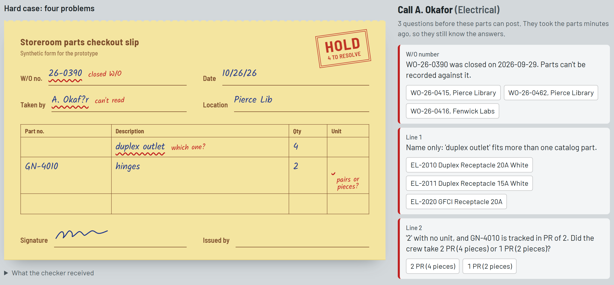

# Slip Check: catch storeroom slip errors at the counter

In a facilities storeroom, crews take parts against a handwritten slip. Mistakes on the slip
(an old, closed work order, a "2" for a part tracked in pairs, a part name with no number,
unreadable handwriting) are made at the counter in seconds but found days later at the stock
count, when the crew has moved on. **Slip Check checks the slip the moment it is entered**,
and tells the clerk exactly what to ask the crew while they are still there.

**Walkthrough video:** [5 min](https://drive.google.com/file/d/13vSLpkyE_olFqDWKH8nPYvmO8nOQbQXe/view?usp=sharing) ·
**Screenshot:** [hard case on hold](docs/hard_case.png)



## Quick start

Python 3.10+. No API key, paid service or Node needed (the built web UI is included).

```bash
python -m venv .venv
.venv\Scripts\activate            # macOS/Linux: source .venv/bin/activate
pip install -r requirements.txt
python -m slipcheck serve         # then open http://127.0.0.1:8000
```

**Try the hard case:** open **Hard case: four problems** → pick *WO-26-0415* → pick a
receptacle → pick *1 PR* → type the name into the review box → the stamp turns to
**READY TO POST** → **Post to inventory**.

Run the tests with `pytest`.

## How it works

```
photo ──► vision extraction (AI, optional) ──┐
                                             ├──► slip JSON ──► deterministic validator ──► clean entry
typed slip (clerk transcription) ────────────┘    (one schema)   (rules, no AI)             + issues
                                                                                             + "call the crew and ask..."
                       low-confidence reads ──► HUMAN_REVIEW (never guessed)
```

**AI only reads; rules decide.** The vision model transcribes the handwriting and gives a
confidence per field. Every decision (does this W/O exist, is it open, which unit, is there
enough stock) is plain code against the catalog and the work orders, so it is repeatable,
testable, and explainable to a supervisor or an auditor.

## Using the app

| Tab | What it shows |
|---|---|
| **Counter** | The slip drawn as the paper copy, problems marked next to each field, a HOLD / READY TO POST stamp, and the questions to ask the crew with one-click answers. Answering re-checks the slip; corrections appear over the struck-through original. Drop in your own photo or JSON slip on the left. |
| **Shift log** | What was posted (W/O, location, parts, aisles, answers given at the counter), what is on hold and why, slips waiting on a handwriting check, problems caught before the count, stock after posting, and **Download for accounting (CSV)**: one row per posted part with the cause of every correction. |
| **Data** | Every part with start, posted and on-hand (low stock flagged), every work order with what was issued against it, and a feed of stock changes. Rows changed by the latest posting are highlighted; refreshes every few seconds. |
| **Impact (estimated)** | Manual vs with the check, with a slider for every input tagged Observed or Assumed and the break-even marked. See [Is it worth it?](#is-it-worth-it-estimated). |

"Post to inventory" re-checks the slip on the server, refuses anything still blocked or
already posted (same W/O, person, date and parts), and lowers on-hand, so the next slip for
that part is checked against the reduced stock. Postings go to a local SQLite file
(`data/runtime/ledger.db`, git-ignored, override with `SLIPCHECK_DB`); nothing leaves the
machine. **Clear shift log** resets it.

## Command line and photos

```bash
python -m slipcheck demo                                       # every sample, one line each
python -m slipcheck check data/slips/01_clean.json             # representative case
python -m slipcheck check data/slips/10_hard_case.json         # difficult case
python -m slipcheck check data/slips/12_truncated.json         # invalid input -> rejected, exit 2
python -m slipcheck check data/slips/10_hard_case.json --json  # machine-readable report
python -m slipcheck impact                                     # estimated manual vs checked comparison

python -m slipcheck check data/photos/slip_hard_case.jpeg                    # photo, cached reading (no key)
python -m slipcheck check data/photos/slip_hard_case.jpeg --live             # photo, read live (ANTHROPIC_API_KEY)
python -m slipcheck check data/photos/slip_hard_case.jpeg --live --save-extraction   # refresh the cached reading
```

Live mode uses Claude Haiku (`SLIPCHECK_MODEL` to override), one call per slip, well under a
cent each. The key can go in a `.env` file in the project folder.

**What happened on the real photos** (two slips handwritten on ruled paper):
- `slip_clean.jpeg` was read exactly and came out `READY`.
- `slip_hard_case.jpeg` came out `BLOCKED` with CLOSED_WO, PART_AMBIGUOUS and UNIT_AMBIGUOUS.
- The model misread "duplex outlet" as **"dupler outlet" at 0.80 confidence**, above the 0.75
  review threshold, so its own confidence did not flag the mistake. The rules still did: the
  misread name matched both duplex receptacles equally, so the crew is asked which one, and
  nothing wrong gets posted. **This is why AI only reads and the rules decide.**
- The name was read at 0.85, so no HUMAN_REVIEW this time; `10_hard_case.json` shows that path.

## Sample data (all synthetic)

| File | What it is |
|---|---|
| `data/catalog.csv` | 60 parts (plumbing, electrical, HVAC, carpentry, paint, custodial): number, name, aliases, **unit of issue** (EA / PR / BX / RL) and pieces per unit, aisle, on-hand, usual max per pull |
| `data/work_orders.csv` | 30 work orders across 10 crews, open and closed, with crew members, location, dates |
| `data/slips/*.json` | 20 slips as a clerk would type them: clean pulls, one per failure mode, a multi-line weekly pull |
| `data/photos/` | two handwritten slips, photographed (see `WHAT_TO_WRITE.md`) |
| `data/extractions/*.json` | the cached Claude readings of those photos, replayed in mock mode |
| `data/impact_assumptions.json` | inputs to the impact estimate, each tagged observed / assumed / unknown |
| `forms/checkout_slip.html` | printable blank slip (optional; a hand-drawn slip works too) |

Buildings, crews, names, part numbers and W/O numbers are invented.

## Examples: input → expected output

| Input | Status | Why |
|---|---|---|
| `01_clean.json` | `READY` | everything checks out |
| `02_closed_wo.json` | `BLOCKED` | CLOSED_WO, suggests WO-26-0412 (same crew + location) |
| `03_pairs_no_unit.json` | `BLOCKED` | UNIT_AMBIGUOUS: "2" hinges = 2 PR or 1 PR? |
| `04_pieces_converted.json` | `READY` | "4 pcs" gloves converted to 2 PR |
| `05_name_only_clear.json` | `READY` | "wax ring", "flapper" auto-matched (score 100 vs next best < 50) |
| `06_name_only_ambiguous.json` | `BLOCKED` | PART_AMBIGUOUS: 20x20 vs 24x24 filter |
| `07_unsigned_big_pull.json` | `BLOCKED` | MISSING_SIGNATURE, UNUSUAL_QTY (30 tubes vs usual max 12) |
| `08_wo_typo.json` | `BLOCKED` | UNKNOWN_WO "26-0142", suggests WO-26-0412 (transposed digits) |
| `09_exceeds_on_hand.json` | `BLOCKED` | EXCEEDS_ON_HAND: 8 belts vs 6 in the system, so recount aisle C04 |
| `10_hard_case.json` | `BLOCKED` | **closed W/O + name-only part + ambiguous "2" + illegible name** |
| `11_invalid_input.json` | `BLOCKED` | blank W/O, name and signature, "a few" qty, junk line: all reported, no crash |
| `12_truncated.json` | `REJECTED` (exit 2) | not valid JSON |
| `13_custodial_restock.json` | `READY` | 4-line restock in boxes, rolls and each |
| `14_ear_plugs_in_pieces.json` | `READY` | "10 pcs" ear plugs converted to 5 PR |
| `15_not_on_crew.json` | `READY_WITH_WARNINGS` | NOT_ON_CREW: electrician from another crew on this W/O |
| `16_wrong_building.json` | `READY_WITH_WARNINGS` | LOCATION_MISMATCH: slip says Knox Hall, W/O is Alcott Residence |
| `17_name_contradicts_number.json` | `BLOCKED` | NAME_NUMBER_MISMATCH: "exit sign" next to a breaker's number |
| `18_same_part_twice.json` | `READY_WITH_WARNINGS` | DUPLICATE_PART: drywall sheets on two lines |
| `19_dated_before_wo.json` | `READY_WITH_WARNINGS` | BEFORE_WO_OPENED |
| `20_weekly_plumbing_pull.json` | `BLOCKED` | 5 lines: two name-only lines matched, "ball valve" ambiguous, "3 pcs" gloves not whole pairs |

Representative case, `python -m slipcheck check data/slips/01_clean.json`:

```
Status: READY
W/O WO-26-0412 | crew Plumbing A | taken by J. Rivera | Harlow Hall | 2026-10-22

Entry to post:
  1. 6 EA           PL-1001 PVC Elbow 90 deg 3/4 in [aisle A03]
  2. 2 EA           PL-1010 Ball Valve 3/4 in Brass [aisle A04]

Nothing to ask the crew. Ready to post.
```

<details>
<summary>Difficult case, full output of <code>python -m slipcheck check data/slips/10_hard_case.json</code></summary>

```
Status: BLOCKED
W/O WO-26-0390 | crew Electrical | taken by A. Okafor | Pierce Library | 2026-10-26

Entry to post:
  1. 4              UNRESOLVED PART
  2. ? (unresolved) GN-4010 Door Hinge 4.5 in Satin Nickel [aisle D02]

Issues:
  [BLOCK] CLOSED_WO            wo_number: WO-26-0390 was closed on 2026-09-29. Parts can't be recorded against it.
           -> Move to WO-26-0415 (OPEN, Electrical, Pierce Library)
  [BLOCK] HUMAN_REVIEW         taken_by: Low-confidence read 'A. Okaf?r' (confidence 0.62). Check against the paper slip; not guessed.
  [BLOCK] PART_AMBIGUOUS       line 1: Name only: 'duplex outlet' fits more than one catalog part.
           -> EL-2010 Duplex Receptacle 20A White [aisle B03] (match 100)
           -> EL-2011 Duplex Receptacle 15A White [aisle B03] (match 100)
           -> EL-2020 GFCI Receptacle 20A [aisle B03] (match 75)
  [BLOCK] UNIT_AMBIGUOUS       line 2: '2' with no unit, and GN-4010 is tracked in PR of 2. Did the crew take 2 PR (4 pieces) or 1 PR (2 pieces)?
           -> 2 PR
           -> 1 PR

Call A. Okafor (Electrical) now and ask:
  1. [wo_number] WO-26-0390 was closed on 2026-09-29. Parts can't be recorded against it.
     Suggested: Move to WO-26-0415 (OPEN, Electrical, Pierce Library)
  2. [line 1] Name only: 'duplex outlet' fits more than one catalog part.
     Options: EL-2010 Duplex Receptacle 20A White | EL-2011 Duplex Receptacle 15A White | EL-2020 GFCI Receptacle 20A
  3. [line 2] '2' with no unit, and GN-4010 is tracked in PR of 2. Did the crew take 2 PR (4 pieces) or 1 PR (2 pieces)?
     Options: 2 PR | 1 PR
```

</details>

## Is it worth it? (estimated)

**These are estimates, not measured savings.** Storeroom volumes are observed (10-20 slips a
normal day, 7-8 count mismatches a week, 30-60 minutes to chase each); most other inputs are
assumed. Only the detection rate is measured: the real checker was run on 2,100 synthetic
slips with one known error each and caught **78%** of slip errors, weighted by an assumed mix.

| | Likely | Optimistic |
|---|---|---|
| Staff hours a week chasing mismatches (today → with check) | 5.6 → 3.8 | 8.0 → 3.2 |
| **Staff hours saved a year** | **+91** (about $2,600) | **+242** |
| **Pays off if at least this share of mismatches start on a slip** | **6%** | **0%** |

The claim worth making is the break-even: the check pays off as long as about 6% or more of
count mismatches start as a slip error. What would sink it is almost all drift coming from
somewhere else (parts taken with no slip, receiving errors, loss); a two-week pilot alongside
the paper process measures exactly that. Run `python -m slipcheck impact` for the full table,
or use the Impact tab to change any input.

<details>
<summary>Inputs, detection by error type, and model limits</summary>

| Input | Low / likely / high | Source |
|---|---|---|
| Slips per week | 50 / 85 / 150 | **observed** |
| Count mismatches per week | 7 / 7.5 / 8 | **observed** |
| Minutes to chase one mismatch | 30 / 45 / 60 | **observed** |
| Share of mismatches caused by a slip error | 20% / 50% / 80% | **assumed**: the key unknown |
| Mix of error types | see file | types **observed**, frequencies **assumed** |
| Minutes to answer a flag at the counter | 2 / 3 / 5 | assumed |
| Seconds the check adds to every slip | 0 / 10 / 20 | assumed |
| Mismatches never traced (left for the yearly audit) | 10% / 25% / 40% | assumed |
| Staff hourly cost (USD) | 22 / 28 / 35 | assumed |
| Who parts were charged to (crew or unit) | not used | **unknown**: decided by management and accounting; changes who pays, not how much |
| Receiving-document call-backs | not counted | **observed**, but about vendor receipts, which this does not touch |

| Error written on the slip | Caught |
|---|---|
| Old, closed W/O number | 100% |
| Pieces written for a pair-tracked part, no unit | 100% |
| Part name only | 100% (84% matched automatically and correctly, 16% sent to a person, 0% wrong) |
| Field too unclear to read | 100% |
| Not signed | 100% |
| Neighbouring part number with the right name | 75% |
| Wrong but plausible quantity | 1%: nothing on the slip contradicts it |

Limits: false alarms on clean synthetic slips are 0%, which is too clean for real handwriting;
each slip error is assumed to cause one count mismatch; staff time only, with no part prices
or write-off value.

</details>

## Implemented / mocked / deferred

| | |
|---|---|
| **Implemented** | every check below; fuzzy part and W/O matching; unit-of-issue conversion; confidence-gated human review; one-click answers that re-check the slip; posting with duplicate protection and stock deduction; shift log; Data tab; accounting CSV with the cause of each correction; detection measurement on injected errors; web UI (React + FastAPI), CLI, JSON output; live photo reading; tests |
| **Mocked** | catalog and work orders are CSVs standing in for the inventory system; "Post to inventory" writes to a local SQLite file. Photo reading defaults to replaying the cached **real Claude readings** of the two handwritten slips, so no key is needed |
| **Estimated** | the hours and dollars on the Impact tab and from `slipcheck impact` |
| **Deferred** | a real inventory system; sign-in for several clerks; notifying crews; part prices and write-off value; multi-page slips; calibrating the model's confidence against real accuracy |

## Known limitations

- The model's own confidence is not calibrated (see "dupler" above). The review threshold (0.75) needs tuning on real slips.
- Location matching handles prefixes ("Pierce Lib") but not arbitrary abbreviations ("Davis Sci Ctr" still warns).
- Offline OCR (e.g. Tesseract) was not used; it performs poorly on handwriting.

## Time, AI use and prior work

**Time spent: about 4.5 hours in total, over the 4-hour guideline.** Split so the in-scope
work can be judged on its own:

| Within about the first 3.5 hours (the brief's prototype) | After, beyond the time limit |
|---|---|
| Rule-based validator with all checks, sample data, CLI, tests | Shift log and posting to the mocked inventory |
| Photo reading (live and mock), confidence-gated human review | Data tab |
| Web UI showing the slip with one-click answers | Impact estimate (CLI and tab) and accounting CSV |
| Representative and invalid-input cases | Larger dataset (60 parts, 30 W/Os, 20 slips) |

I went past the limit on the shift log and the estimate because a claim that the check saves
time needed something to back it. Both are labeled as estimated where they estimate.

**AI use.** Built with Claude Code (Claude) as a pair programmer: scaffolding, most of the
code, the UI, and drafting this README. The problem, the storeroom facts and every observed
number come from my own work in the storeroom; the AI did not supply them. How I checked its
output:
- ran every sample slip and compared each report with the failure it was written to show;
- drove the web UI in a real browser (scripted with Playwright) through the full demo path and at phone width;
- a test suite for every rule, the API, the shift log and the impact model;
- corrected it where its assumptions did not fit my storeroom (for example, who parts are
  charged to is unknown to me, so it is left out, and receiving call-backs are not counted as savings).

**Prior work reused:** none; written for this case study.

## What I would investigate next

1. **How much stock drift comes from parts taken with no slip at all.** If that dominates, a slip checker can't fix it, and that is the result that would make me stop.
2. **How soon slips are actually entered.** Catching errors "while the crew is reachable" assumes same-day entry; batch entry at week's end shrinks the benefit.
3. Error frequency by type on real slips, to decide which checks earn their place.
4. Photo-reading accuracy on 50+ real handwritten slips, and where to set the review threshold.
5. **The same check on the receiving side.** Vendor documents were already reviewed within 1-2 days; reading them automatically and matching them to the order and to what was put away is the same pattern.

---

<details>
<summary>Reference: every check</summary>

| Code | Severity | Who answers |
|---|---|---|
| `CLOSED_WO`, `UNKNOWN_WO`, `MISSING_WO` | block | crew (an open W/O on the same crew + location is suggested) |
| `UNIT_AMBIGUOUS` | block | crew. A bare number on a pair/box part is **never** converted silently |
| `UNIT_REMAINDER` | block | crew ("3 pieces" of a pair-issued part) |
| `UNIT_CONVERTED`, `UNIT_ASSUMED` | info / warn | written unit converted; odd bare number read as pairs |
| `PART_AMBIGUOUS`, `NAME_NUMBER_MISMATCH`, `NO_PART` | block | crew |
| `NAME_MATCHED` | info | auto-match only if score ≥ 88 **and** ≥ 12 ahead of the runner-up |
| `UNKNOWN_PART`, `BAD_LINE` | block | storeroom desk |
| `EXCEEDS_ON_HAND` | block | desk: slip or count is already wrong, recount the aisle |
| `UNUSUAL_QTY`, `DUPLICATE_PART`, `LOCATION_MISMATCH`, `NOT_ON_CREW` | warn | |
| `MISSING_SIGNATURE`, `MISSING_TAKEN_BY`, `MISSING_QTY`, `BAD_QTY` | block | crew |
| `HUMAN_REVIEW` | block | desk: any field read with confidence < 0.75; illegible ≠ blank |
| `MISSING_DATE`, `BAD_DATE`, `FUTURE_DATE`, `BEFORE_WO_OPENED` | warn | |

Status is `BLOCKED` if anything blocks, else `READY_WITH_WARNINGS`, else `READY`.

</details>

<details>
<summary>Reference: dependencies, stack and frontend development</summary>

| Package | Needed for |
|---|---|
| `rapidfuzz` | core fuzzy matching (offline) |
| `fastapi`, `uvicorn`, `python-multipart` | API and web UI server |
| `anthropic`, `pillow` | live photo reading only: API client, and straightening/shrinking phone photos |
| `python-dotenv` | optional: reads `ANTHROPIC_API_KEY` from `.env` |
| `pytest`, `httpx` | tests |

| Layer | Stack |
|---|---|
| UI | React 19, TypeScript, Vite 8, Tailwind CSS 4 (`frontend/`) |
| API | FastAPI (`slipcheck/api.py`) |
| Rules | plain Python (`slipcheck/validate.py`), shared with the CLI |
| Reading photos | Claude Haiku vision, or cached readings (`slipcheck/extract.py`) |
| Shift log and estimate | `slipcheck/ledger.py` (SQLite), `slipcheck/impact.py` |

Changing the UI (Node 20+):

```bash
python -m slipcheck serve                       # API on :8000
cd frontend && npm install && npm run dev       # UI on :5173, proxies /api to :8000
npm run build                                   # rebuild frontend/dist, which the Python server serves
```

After changing Python code, restart `serve`: the server loads code once, at start. The page
says so if it is newer than the running server.

</details>
